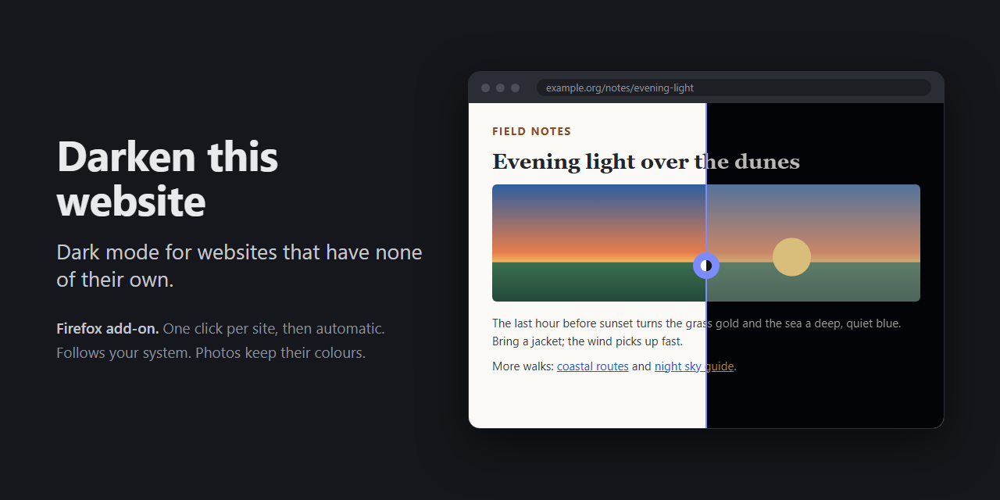

<p align="center"><picture><source media="(prefers-color-scheme: dark)" srcset="logo/darken-this-website-256.png"></picture></p>

# Darken this website

A Firefox add-on that gives a dark mode to websites that have none of their own. Switch a site on once
with a click; from then on it is dark automatically every time you open it. The page is inverted and
dimmed a little; photos and video keep their real colours. It follows your system: in dark mode your
sites are dark, in light mode they look as usual.

For privacy reasons this add-on is not in the Firefox add-on store: you build and sign your own copy,
which takes a few minutes (see *Install*).

## Why build your own?

A dark-mode add-on needs to read and change every page you visit, including your bank, your mail and
anything you type. That is a lot of trust to hand to someone else's code:

- **Store add-ons update themselves.** An add-on that is fine today can be sold to a new owner or
  changed tomorrow, and the new code reaches you without a question. Your own copy changes only when
  you change it.
- **You can read all of it.** One short script, no libraries, no network calls. You can check what it
  does in a minute instead of taking a privacy policy's word for it.
- **You can make it yours.** The dimming, the colours and the dark-mode behaviour are four settings at
  the top of `background.js` (see *Tuning*).

Signing it on addons.mozilla.org (see *Install*) only means Mozilla checks and signs the file; it stays
private and does not appear in the store.

## How it works

<p align="center"></p>

- **Click the icon or press Alt+Shift+M:** the site is switched on and remembered. From then on it is
  dark on every load, before the page is drawn. Click again to switch it off and forget it.
- **What you see:** dark background, light text, blue links turn yellow, the page dimmed to 85 %.
  Images, video, canvas and iframes are inverted back, so photos are not negatives, and dimmed a little
  more (about 64 %). This also works inside open shadow roots, such as video players built as web
  components; closed shadow roots cannot be reached.
- **System dark mode:** remembered sites are dark only while the system is in dark mode. Switch to light
  mode and every darkened tab is restored at once; switch back and they go dark again. A click works in
  either mode and lasts until the next load. "Dark mode" is what Firefox reports to pages as
  `prefers-color-scheme`: your operating system's setting, unless a Firefox theme or *Website appearance*
  in Firefox's settings overrides it.
- **`!` badge:** Firefox does not allow add-ons on that page (about: pages, addons.mozilla.org, the PDF
  viewer).
- **Privacy:** permissions are `activeTab`, `storage` and access to all sites, so switching a site on never
  needs a prompt. No script runs on sites you did not switch on. No network. The list of switched-on
  sites is the only thing stored.

## Install

Normal Firefox only installs add-ons that Mozilla has signed. Signing for your own use is free, takes a
few minutes, and keeps the add-on private: it is not published in the add-on store.

### Sign it once on addons.mozilla.org

1. Run `build.ps1`. It makes `darken-this-website.xpi`. Or download the prebuilt
   [release](https://github.com/roosmsg/darken-this-website/releases/latest).
2. Go to the [Developer Hub](https://addons.mozilla.org/developers/) and sign in with a Mozilla account
   (create one if you have none). The first time, accept the developer agreement.
3. Click **Submit a New Add-on** and choose **On your own**. This is *self-distribution*: Mozilla signs
   the add-on but does not list it anywhere.
4. Upload `darken-this-website.xpi`. Mozilla runs automatic checks; warnings are fine, errors are not.
5. When asked whether you need to submit source code, answer **No**: nothing is minified or bundled.
6. Submit. Signing usually takes a few minutes, and you get an email when it is done.
7. Open the add-on in the Developer Hub (*My Add-ons*), go to *Manage Status & Versions* and download
   the signed `.xpi`.
8. Open the signed file in Firefox (Ctrl+O, or drag it onto a window) and click **Add**.

Keep the signed file: it installs on every computer you use, without signing again.

### A new version

Mozilla signs each version number only once. After a change:

1. Raise `version` in `manifest.json` (for example 1.4.0 → 1.4.1) and run `build.ps1`.
2. On the add-on's page in the Developer Hub, choose **Upload New Version** and follow steps 4–8.

The new version installs over the old one and keeps your site list. A self-distributed add-on does not
update itself; install each new version by hand.

### From the command line (optional)

With Node.js installed, [web-ext](https://extensionworkshop.com/documentation/develop/web-ext-command-reference/)
does the upload and download in one step:

```
npx web-ext sign --channel=unlisted --api-key=<JWT issuer> --api-secret=<JWT secret>
```

Get the key and secret from [API keys](https://addons.mozilla.org/developers/addon/api/key/) in the
Developer Hub. The signed `.xpi` lands in `web-ext-artifacts/`.

### Without signing

- **For a quick try** (gone after a restart): open `about:debugging#/runtime/this-firefox`, click *Load
  Temporary Add-on…* and pick `manifest.json`.
- **Firefox ESR, Developer Edition or Nightly:** set `xpinstall.signatures.required` to `false` in
  `about:config`, then open the unsigned `darken-this-website.xpi` (Ctrl+O) and confirm.

## Moving to another computer

The add-on does not travel with Firefox Sync. Sync only carries add-ons that are listed on
addons.mozilla.org; a self-distributed add-on is invisible to it, and so is the list of switched-on
sites, which lives in the add-on's local storage on that machine. On a new computer:

1. Open the signed `.xpi` you kept in Firefox and click **Add** (or sign it again, see *Install*).
2. Switch your sites on again with a click.

If you want the site list to follow you, change `browser.storage.local` to `browser.storage.sync` in
`background.js` (and raise the version); Firefox then syncs the list between machines that have the
add-on installed and are signed in to the same account.

## Build

`build.ps1` packs `manifest.json`, `background.js` and `icon.svg` into `darken-this-website.xpi`.

## Tuning

At the top of `background.js`: `DIM` (0.85), `MEDIA_DIM` (0.75, extra dim for images and video),
`KEEP_HUES` (off) and `FOLLOW_SYSTEM` (on). Switching `KEEP_HUES` on rotates hues 180 degrees after
inverting so blue links stay blue, at a price: Firefox clamps colours between the two filter passes, so
saturated photos come back slightly duller. Switching `FOLLOW_SYSTEM` off makes remembered sites dark
whatever the system does. Rebuild the `.xpi` afterwards (and raise the version if you sign it).

## Credits and license

Forked from [lineality/invert_colors_minimal_firefox_addon](https://github.com/lineality/invert_colors_minimal_firefox_addon)
and kept in the same spirit: a handful of lines you can read in a minute. Its README is kept unchanged
in `README.original.md`.

MIT, as the original. See `LICENSE`.
